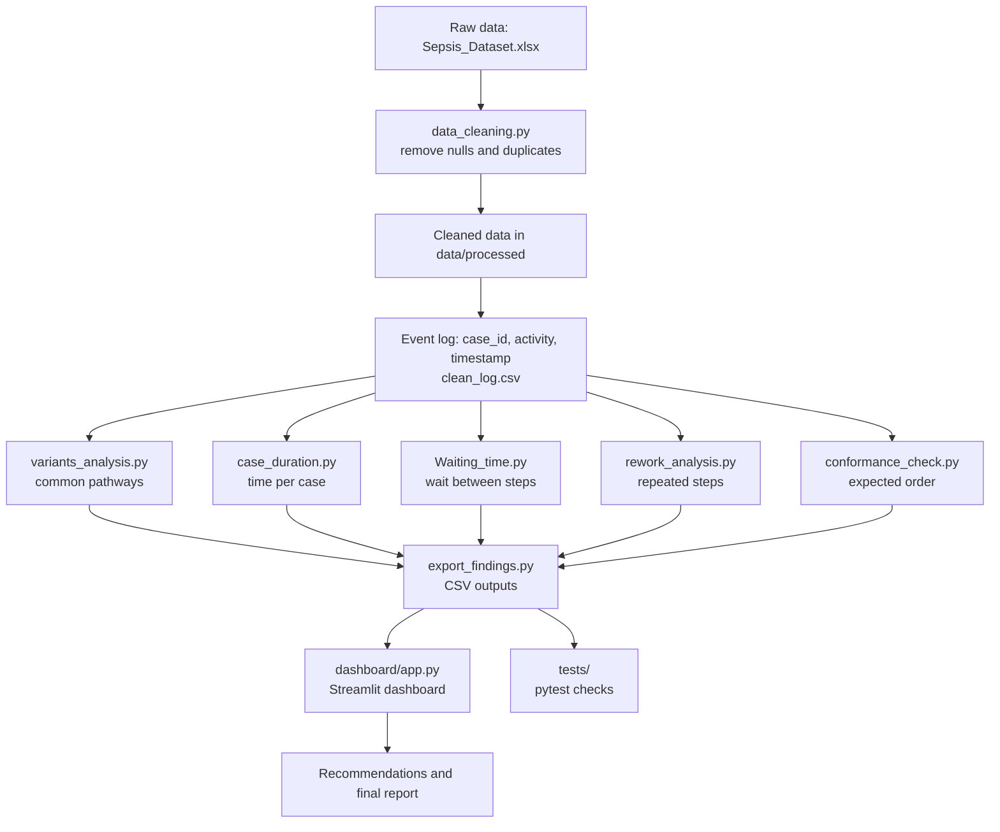

## Project Workflow

### Steps in words
1. **Collect and clean**: load the dataset, check nulls and duplicates, save the cleaned file.
2. **Build the event log**: each row needs a case ID, an activity and a timestamp.
3. **Analyse**: variants, case duration, waiting time, rework and conformance.
4. **Export**: save the results as CSV files.
5. **Visualise**: the Streamlit dashboard shows KPIs, charts and filters.
6. **Test**: pytest checks missing values, ordering and negative times.
7. **Report**: write recommendations, the final report and the presentation.

### Weekly timeline
| Week | Focus |
|------|-------|
| 1 | Setup, data collection, cleaning |
| 2 | Event log, variants, case duration |
| 3 | Waiting time, rework, conformance, dashboard |
| 4 | Tests, recommendations, final report, presentation |
